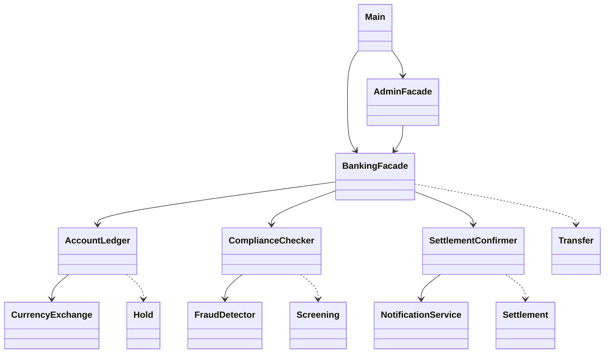

# Online Banking

## Problem

A bank transfer goes through 3 independent subsystems: reserve money, check the recipient, send money to the other bank.
If a later step fails, the earlier ones must be undone. The client should not know about any of this.

Basically I had:

`AccountLedger` (A) - holds money on the account, `CurrencyExchange` converts currency, `Hold` - HELD / CAPTURED / RELEASED

`ComplianceChecker` (B) - sanctions check, `FraudDetector` blocks more than 3 transfers in 24h, `Screening` - PENDING / CLEARED / REJECTED / REVOKED

`SettlementConfirmer` (C) - sends money to the beneficiary bank, `NotificationService` builds the message, `Settlement` - PENDING / SETTLED / FAILED

`BankingFacade` - client facade, runs A -> B -> C and rolls back on failure

`AdminFacade` - inspect, cancel, recover unfinished transfers

`Transfer` - one transfer and its chain status, saved after every step so it survives a restart

- B fails -> release the hold (A)
- C fails -> revoke the screening (B), then release the hold (A)

## Run

```bash
./mvnw -q compile exec:java
```

Data is in `data/`, to reset: `rm -rf data`

To show failures: sanction `GB29NWBK60161331926819` (menu 7) or close `FR1420041010050500013M02606` (menu 8) and send money there.
To show restart: begin a transfer (menu 3), exit, start again, recover (menu 10).

## UML



## Least Knowledge

Without facade:

```java
ledger.placeHold(id, "ACC1", amount, "USD");
if (compliance.screen(id, "ACC1", iban).status() != CLEARED) { ledger.release(id); return; }
if (settlement.settle(id, iban, amount, "USD").status() != SETTLED) { compliance.revoke(id); ledger.release(id); return; }
ledger.capture(id);
```

With facade:

```java
bank.transfer("ACC1", iban, amount, "USD");
```

## Facade vs Adapter

Adapter changes the interface of one class. Here no interface is wrong. The problem is one operation needs 3 subsystems
in the right order with rollback, so Facade gives one simple entry point and owns that logic.

## Tests

```bash
./mvnw verify
```

Coverage report: `target/site/jacoco/index.html` (~97%). `BankScenario` is the test DSL:
`scenario.sends("100", "USD").from(alice).to(CLOSED_IBAN)`.
